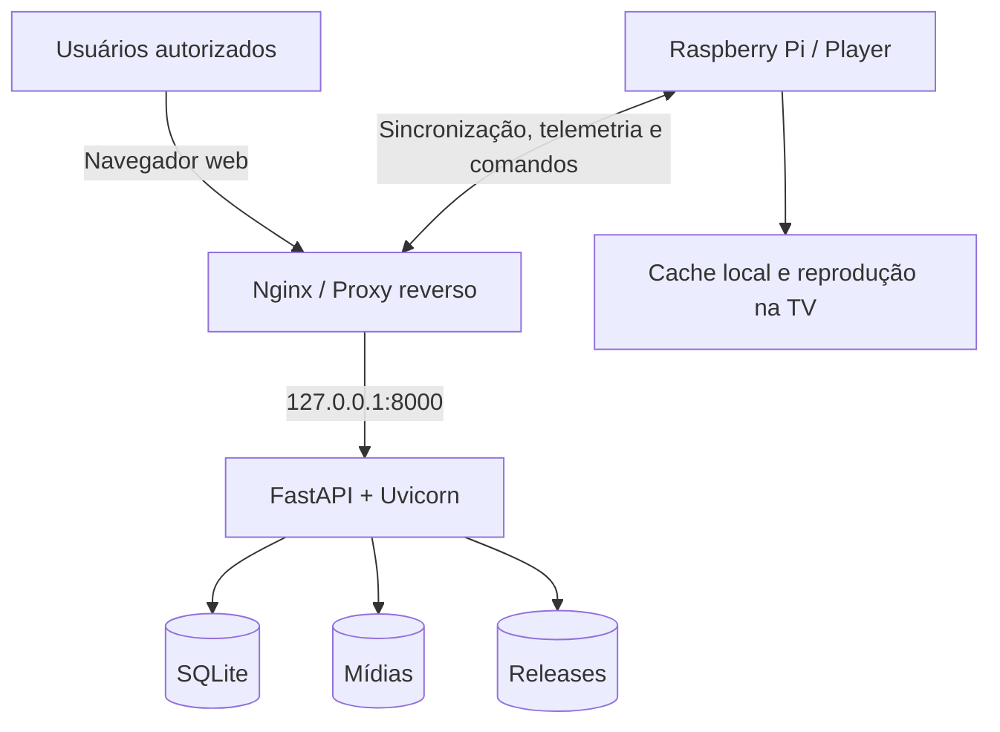

# Digital Signage

### Plataforma corporativa de gerenciamento, distribuição e monitoramento de conteúdos digitais

**Desenvolvimento:** Victor Gabriel  
**Aplicação de referência:** Arvedi Metalfer do Brasil  
**Fase atual:** preparação e homologação da implantação em Linux

---

## Visão geral

O **Digital Signage** é uma plataforma de sinalização digital idealizada e desenvolvida para simplificar a comunicação visual em ambientes corporativos. Por meio de uma interface web centralizada, os setores podem organizar conteúdos, criar playlists, programar exibições e acompanhar o funcionamento das TVs, respeitando as permissões de acesso atribuídas a cada usuário.

A reprodução é realizada por **players conectados às TVs**, incluindo dispositivos **Raspberry Pi**. O servidor concentra o gerenciamento, a publicação de conteúdo e a comunicação com os dispositivos; os players ficam responsáveis pela apresentação das mídias e pelo cache local, permitindo continuidade de reprodução em interrupções temporárias de conectividade.

O projeto foi pensado para reduzir intervenções manuais, padronizar a publicação de informações e oferecer autonomia às áreas autorizadas, sem perder o controle centralizado da equipe de TI.

> **Status:** a aplicação está em evolução e a implantação no Ubuntu Server 24.04 LTS encontra-se em fase de **homologação controlada**. A entrada em produção depende da validação no ambiente Linux e de testes com um Raspberry Pi piloto.

## Principais funcionalidades

| Módulo | Capacidades |
| --- | --- |
| **Dashboard** | Visão centralizada de TVs, players e operação da plataforma. |
| **Biblioteca de mídias** | Envio e organização de imagens e vídeos, com visualização prévia. |
| **Playlists** | Criação, edição, ordenação de itens, definição de duração e publicação versionada. |
| **Agendamentos** | Programação de playlists e conteúdos para períodos específicos. |
| **Gestão de TVs** | Cadastro, associação de playlists e configuração de dispositivos. |
| **Usuários e permissões** | Perfis administrativos e restrições de acesso às TVs autorizadas. |
| **Monitoramento** | Heartbeat, indicadores operacionais, eventos de estabilidade e diagnóstico de players. |
| **Operação remota** | Comandos, manutenção e provisionamento de dispositivos autorizados. |
| **Releases de players** | Distribuição e acompanhamento de atualizações, com verificação de integridade. |
| **Auditoria** | Registro de operações administrativas e ações relevantes. |
| **Continuidade** | Cache local nos players, procedimentos de backup, restauração e rollback. |

### Formatos de mídia

- **Imagens:** JPG, JPEG, PNG, WEBP e GIF.
- **Vídeos:** MP4, com validação técnica apoiada pelo `ffprobe`.

PDF e PowerPoint **não fazem parte dos fluxos ativos de upload e reprodução** na versão revisada.

## Arquitetura



### Componentes

| Camada | Tecnologia / responsabilidade |
| --- | --- |
| Aplicação web | Python, FastAPI, Jinja2 e JavaScript. |
| Servidor ASGI | Uvicorn. |
| Proxy reverso | Nginx. |
| Banco de dados | SQLite. |
| Gerenciamento de serviços | systemd. |
| Sistema operacional alvo | Ubuntu Server 24.04 LTS, com Python 3.12. |
| Análise de vídeo | FFmpeg / ffprobe. |
| Reprodução | Raspberry Pi com navegador/player local, watchdog e cache offline. |

No servidor Linux, o **Nginx recebe as conexões de rede**, enquanto o **Uvicorn escuta apenas em `127.0.0.1:8000`**, com **um worker** na arquitetura atual. Código, configuração, banco, mídias e releases ficam em locais separados para facilitar atualizações e recuperação.

## Estrutura do projeto

A organização da versão Linux revisada é, em linhas gerais:

```text
DigitalSignage/
├── app.py                         # Aplicação FastAPI e regras de negócio
├── stability_monitor.py           # Monitoramento de estabilidade
├── requirements.txt               # Dependências diretas
├── requirements-constraints.txt   # Restrições de versões transitivas
├── requirements-dev.txt           # Dependências de desenvolvimento/testes
├── templates/                     # Interfaces web
├── bootstrap/
│   └── install_player.sh           # Provisionamento inicial do player
├── player/                         # Componentes/documentação do player
├── deploy/
│   └── linux/                      # Instalação, serviços, backup e retenção
├── docs/
│   ├── arquitetura/
│   └── deploy/                     # Guias Linux, hardening e validação
└── tests/                          # Testes automatizados
```

> **Nota:** os diretórios `player/`, `deploy/linux/` e os documentos adicionais correspondem à evolução descrita na revisão de segurança. Confirme que estão incluídos na branch publicada antes de divulgar o repositório.

## Primeiros passos — ambiente de desenvolvimento

### Pré-requisitos

- Python compatível com as dependências fixadas (alvo Linux: **Python 3.12**).
- `git`, `venv` e `pip`.
- FFmpeg/`ffprobe` disponível no `PATH`.
- Acesso a um ambiente de teste sem dados operacionais.

```bash
git clone <URL_DO_REPOSITORIO> digital-signage
cd digital-signage

git switch redesign-workspace-v4

python3 -m venv .venv
source .venv/bin/activate

python -m pip install --upgrade pip
python -m pip install -r requirements.txt -c requirements-constraints.txt
```

Crie um banco novo e um administrador **somente em ambiente de desenvolvimento**. Utilize credenciais fortes e não faça commit de arquivos `.env`, tokens ou bancos de dados:

```bash
export DS_DB_FILE="$(pwd)/digital_signage.db"
export DS_MEDIA_DIR="$(pwd)/media"
export DS_RELEASE_DIR="$(pwd)/releases"
export DS_INITIAL_ADMIN_USER="admin"
export DS_INITIAL_ADMIN_PASSWORD="<SENHA_FORTE_DE_TESTE>"
export DS_REQUIRE_DEVICE_TOKEN="1"
export DS_ALLOW_LEGACY_PUBLIC_MEDIA="0"

uvicorn app:app --host 127.0.0.1 --port 8000
```

Acesse `http://127.0.0.1:8000/login` para abrir a interface e `http://127.0.0.1:8000/health` para verificar a saúde do serviço. **Não publique a senha inicial, nem mantenha as variáveis de bootstrap após criar o administrador.**

## Implantação em Ubuntu Server 24.04 LTS

A instalação corporativa utiliza os scripts e exemplos versionados em `deploy/linux/`, com procedimentos de homologação documentados em [`docs/deploy/LINUX_SERVER.md`](docs/deploy/LINUX_SERVER.md).

### Infraestrutura inicial sugerida

- **VM:** 2–4 vCPU e 4–8 GB de RAM (dimensionar mediante testes).
- **Disco:** SSD com capacidade adequada ao volume e à retenção de vídeos.
- **Rede:** DNS interno, IP fixo e regras de firewall restritivas.
- **Sistema:** Ubuntu Server 24.04 LTS, com fuso `America/Sao_Paulo`.
- **Dependências:** Python 3, Nginx, SQLite, FFmpeg e ferramentas de instalação.
- **Recuperação:** cópia local e externa dos backups, com restauração testada.

### Sequência de implantação

1. Preparar uma **VM isolada**, inicialmente sem dados operacionais.
2. Clonar a branch revisada e conferir os arquivos de `deploy/linux/`.
3. Executar o instalador `deploy/linux/install-server.sh` de acordo com o guia de implantação.
4. Criar `/etc/digital-signage/server.env` com permissões restritas, a partir do exemplo fornecido.
5. Executar o preflight da aplicação e validar sistema, diretórios, banco, dependências e rede.
6. Habilitar `digital-signage.service` e configurar o Nginx como proxy reverso.
7. Validar login, `/health`, uploads, reprodução parcial de vídeos e permissões.
8. Testar **backup, restore e rollback** com dados sintéticos.
9. Configurar **um Raspberry Pi piloto**, validando sincronização, heartbeat, cache e reprodução.
10. Somente após a homologação, migrar banco, mídias e releases do Windows e transferir os demais players gradualmente.

**Exemplos de verificação no Ubuntu:**

```bash
sudo systemctl status digital-signage --no-pager
sudo journalctl -u digital-signage -n 100 --no-pager
sudo nginx -t
curl -i http://127.0.0.1:8000/health
```

### Diretórios no servidor

```text
/opt/digital-signage/app/                # Código versionado
/opt/digital-signage/venv/               # Ambiente Python
/etc/digital-signage/server.env          # Configuração e segredos
/var/lib/digital-signage/               # Banco, mídias e releases
/var/backups/digital-signage/            # Backups
```

**Importante:** a operação inicial descrita no plano corporativo utiliza acesso HTTP interno durante a homologação. Para operação definitiva, recomenda-se **HTTPS**, certificado confiável, configuração adequada de cookies e controle de acesso à rede. O Nginx **não deve servir `/media/` diretamente por `alias`**, contornando a autorização da aplicação.

## Segurança

Na revisão de hardening da versão em preparação para Linux, foram implementados ou previstos os seguintes controles:

- **Controle de acesso às mídias** por sessão administrativa ou credencial de dispositivo, respeitando o escopo de usuário/TV.
- **Permissões baseadas em papéis (RBAC)** e verificações de acesso por TV.
- **Proteção CSRF** em formulários e operações administrativas autenticadas por cookie.
- **Credenciais de dispositivo** por Bearer ou `X-Device-Token`, com revogação/rotação.
- **Uploads limitados e validados**, com leitura em chunks e limpeza de temporários inválidos.
- **Integridade de releases** por SHA-256.
- **Rotinas de backup e retenção**, com limpeza em modo simulado (*dry-run*) por padrão.
- **Segredos fora do Git** e separação de código e dados operacionais.

A configuração `DS_ALLOW_LEGACY_PUBLIC_MEDIA=1` serve apenas a uma eventual transição controlada de compatibilidade; mantenha-a **desativada** no ambiente protegido.

Consulte [`docs/deploy/HARDENING.md`](docs/deploy/HARDENING.md) para o escopo completo e as ressalvas de homologação.

> **Segurança operacional:** não adicione ao repositório bancos reais, mídias internas, tokens, logs sensíveis, arquivos `server.env` ou endereços/credenciais da infraestrutura corporativa.

## Players Raspberry Pi

O player local é responsável por solicitar atualizações de conteúdo, armazenar mídias em cache, realizar a reprodução na TV e enviar telemetria ao servidor. O provisionamento inicial utiliza um código gerado pela interface de administração e uma release estável cadastrada no servidor.

O mecanismo de instalação está representado por `bootstrap/install_player.sh`. Antes de usá-lo, revise o código, a release publicada e as instruções específicas do player. **Não execute scripts remotos diretamente sem verificá-los.**

Na migração, altere o endereço do servidor inicialmente em **um dispositivo piloto** e preserve credenciais válidas. A entrega protegida de mídia e o cache offline precisam ser testados juntos antes do corte dos demais players.

## Testes e homologação

Os testes automatizados podem ser executados com:

```bash
python -m pytest -q
```

A revisão de hardening registrou **114 testes Python aprovados** no ambiente de desenvolvimento e uma suíte complementar de JavaScript aprovada. Esse resultado **não substitui** os testes pendentes em Ubuntu Server, Nginx, systemd, backup externo e Raspberry Pi real.

Critérios mínimos antes da entrada em produção:

- [ ] Instalação limpa validada no Ubuntu Server 24.04 LTS.
- [ ] Serviço e proxy funcionam após reinicialização do servidor.
- [ ] Usuários, permissões e CSRF validados no navegador.
- [ ] Uploads e vídeos MP4 testados em condições reais, inclusive HTTP 206/Range.
- [ ] Raspberry piloto sincroniza e reproduz conteúdos com cache offline.
- [ ] Backup íntegro e restauração comprovada em ambiente isolado.
- [ ] Retenção avaliada em *dry-run* antes de habilitar exclusões.
- [ ] Procedimento de rollback testado e ambiente anterior preservado durante a transição.

## Documentação técnica

| Documento | Conteúdo |
| --- | --- |
| [`docs/deploy/LINUX_SERVER.md`](docs/deploy/LINUX_SERVER.md) | Preparação do servidor e sequência de implantação. |
| [`docs/deploy/VALIDACAO_LINUX.md`](docs/deploy/VALIDACAO_LINUX.md) | Verificações técnicas e critérios de aceite. |
| [`docs/deploy/HARDENING.md`](docs/deploy/HARDENING.md) | Controles de segurança e decisões de hardening. |
| [`docs/arquitetura/PLAYER_ATUAL.md`](docs/arquitetura/PLAYER_ATUAL.md) | Arquitetura e compatibilidade do player. |
| [`player/README.md`](player/README.md) | Informações operacionais do player. |

## Evolução planejada

O projeto busca ampliar sua confiabilidade e facilidade de operação, com foco em:

- Conclusão da homologação Linux e migração gradual dos dispositivos.
- Monitoramento contínuo, observabilidade e recuperação operacional.
- Melhorias na experiência de administração de conteúdos e playlists.
- Evolução do processo de atualização e suporte aos players.
- Avaliação de arquiteturas futuras de maior escala, conforme a demanda e os requisitos de segurança.

## Autoria e créditos

O **Digital Signage foi idealizado e desenvolvido por Victor Gabriel**, no contexto das necessidades de comunicação visual da **Arvedi Metalfer do Brasil**.

O trabalho compreendeu a concepção da solução, definição de arquitetura, desenvolvimento da aplicação, integração com dispositivos de reprodução, implementação de funcionalidades, testes, análise de problemas e evolução técnica. Ferramentas de inteligência artificial foram utilizadas como apoio supervisionado à programação, revisão de código e documentação, cabendo ao idealizador a condução das decisões funcionais e técnicas do projeto.

**Idealização, arquitetura e desenvolvimento:** Victor Gabriel  
**Contexto organizacional:** Tecnologia da Informação — GSS | Arvedi Metalfer

## Uso e propriedade intelectual

Desenvolvido para uso no contexto corporativo indicado. A publicação deste README **não concede, por si só, licença de uso, redistribuição ou exploração comercial do código**. A disponibilização pública do repositório, a inclusão de uma licença e a definição de direitos sobre o software devem ser previamente alinhadas com os responsáveis e titulares aplicáveis.

---

<p align="center"><strong>Digital Signage</strong> — comunicação visual centralizada, operação mais simples e evolução contínua.</p>
