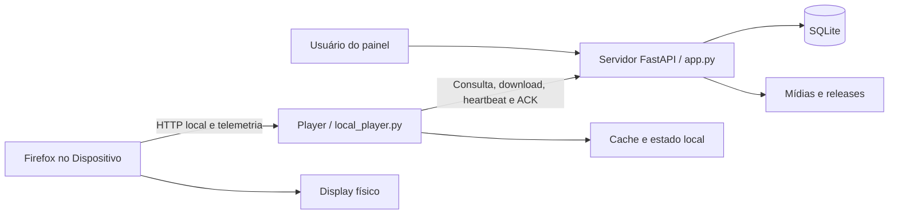

# Arquitetura atual do Digital Signage

Registro de referência em 14/10/2026, anterior ao redesign. Baseado na análise estática do servidor e da cópia do Player fornecida pelo responsável. Este documento descreve implementação observada, não certificação da implantação em produção.

## Escopo e fontes

- Servidor: raiz `C:\DigitalSignage`, atualmente sob Git.
- Player: cópia externa denominada `DigitalSignagePlayer`, fornecida para análise; não pertence à árvore de código rastreada deste repositório.
- Fontes principais: [app.py](../../app.py), [stability_monitor.py](../../stability_monitor.py), [templates](../../templates), [bootstrap](../../bootstrap/install_player.sh), [deploy](../../deploy/digital-signage.service.example) e [requirements.txt](../../requirements.txt).
- Referências a funções são preferíveis a números de linha, que podem mudar. Nomes de arquivos do Player neste documento são relativos à cópia externa analisada.
- Mockups, capturas, `DESIGN.md` e `code.html` não definem funcionalidades, contratos ou dados reais.

## Visão geral

O servidor reúne painel administrativo, regras operacionais, persistência SQLite e APIs de consumo pelo Player. O Raspberry consulta essas APIs, mantém mídia local, executa a reprodução em Firefox e envia telemetria. O fluxo é predominantemente de consultas HTTP periódicas, não de push para os Dispositivos.

**`app.py` é a entrada do servidor. `local_player.py` é a entrada efetiva do Player fornecido**, conforme `services/digital-signage-player.service`.

Tela corresponde à entidade `tvs`, identificada por `tv_id`. Dispositivo representa o Raspberry Pi associado à Tela; Player é o software executado no Dispositivo; Display é a TV ou monitor físico. O Display não possui entidade independente no banco. A disponibilidade estimada não comprova que o Display esteja fisicamente ligado ou exibindo imagem.

## Estrutura do servidor

| Caminho | Papel confirmado |
|---|---|
| `app.py` | Aplicação FastAPI, rotas, SQL, autenticação, autorização, mídia e monitor operacional |
| `stability_monitor.py` | Schema, ingestão, retenção e resumo de estabilidade |
| `templates/` | HTML Jinja2, CSS e JavaScript incorporados |
| `digital_signage.db` | Banco operacional padrão, ignorado pelo Git |
| `media/uploads/`, `media/rendered/` | Arquivos de mídia; toda a pasta `media/` é operacional e ignorada |
| `releases/` | Pacotes ZIP do Player, ignorados |
| `bootstrap/install_player.sh` | Provisionamento e instalação Linux |
| `deploy/` | Exemplos de serviço e ambiente do servidor |
| `tests/test_permissions.py` | Testes de autorização, não executados nesta documentação |
| `backup/`, `updates/`, `_update_224/`, `.BKP*` e ZIPs | Histórico local, fora do código ativo rastreado |

As rotas estão concentradas em `app.py`, sem divisão em `APIRouter`. Não há camada independente de serviços ou ORM. Funções utilitárias e SQL ficam majoritariamente no mesmo módulo. Não foi identificada pasta separada de CSS/JavaScript do painel.

## Tecnologias e dependências

Confirmadas: Python, FastAPI, Uvicorn, Jinja2, SQLite via `sqlite3`, HTML, CSS, JavaScript e python-multipart. PyMuPDF é importado como `fitz`. O servidor usa `ffprobe` para metadados/validação; há funções de conversão PDF/PowerPoint com PyMuPDF/LibreOffice, sem chamadas no fluxo ativo de upload analisado.

O Player utiliza biblioteca padrão Python, HTTP local com `ThreadingHTTPServer`, Firefox em kiosk, Linux, systemd e ferramentas de rede. Não é outra aplicação FastAPI. Existem nomes internos `chromium_*`, embora a implementação fornecida localize e execute Firefox.

`requirements.txt` não fixa versões. A disponibilidade de `tzdata` é relevante para `ZoneInfo("America/Sao_Paulo")`. Na análise anterior, `ffprobe` não foi localizado no PATH da sessão Windows; LibreOffice foi localizado. Isso não comprova a configuração de todos os ambientes.

## Inicialização

O alvo ASGI é `app:app`. A documentação local de implantação apresentou Uvicorn em `0.0.0.0:8000` no Windows. O exemplo Linux em `deploy/digital-signage.service.example` usa `127.0.0.1:8000`, um worker e reinício em falha. O comando efetivamente em execução não foi confirmado.

Importar `app.py` já produz efeitos persistentes:

1. Cria diretórios de banco, mídia e releases.
2. Executa `init_db()`, cria tabelas e acrescenta colunas.
3. Cria administrador inicial quando não há usuários e pode gravar `first_admin_credentials.txt`.
4. Cria Tela padrão ausente e ajusta dados antigos de imagens.
5. Migra playlists com itens e sem publicação para uma publicação inicial.
6. Inicializa histórico, registra releases empacotadas e pode ajustar a versão recomendada.
7. Inicializa o schema de estabilidade.

O evento de startup inicia thread de monitoramento com ciclo de dez segundos. O controle dessa thread é por processo; múltiplos workers exigem planejamento. O banco e os diretórios operacionais precisam de permissões de escrita. A criação do diretório do banco usa `parents=True`; a dos diretórios principais de mídia/releases não cria automaticamente toda a cadeia de pais.

| Variável | Finalidade |
|---|---|
| `DS_DB_FILE` | Caminho do SQLite |
| `DS_MEDIA_DIR` | Raiz de mídia |
| `DS_RELEASE_DIR` | Pacotes do Player |
| `DS_SESSION_TTL_SECONDS` | Validade da sessão; padrão 12 horas |
| `DS_PASSWORD_ITERATIONS` | Custo PBKDF2 |
| `DS_INITIAL_ADMIN_USER`, `DS_INITIAL_ADMIN_PASSWORD` | Primeiro acesso em banco sem usuários |
| `DS_COOKIE_SECURE` | Exigência de HTTPS para cookie |
| `DS_REQUIRE_DEVICE_TOKEN` | Exigir token também para Tela ainda sem hash cadastrado |
| `LIBREOFFICE_PATH` | Caminho do conversor |

Há valores padrão; isso não equivale a configuração adequada para produção. O fuso operacional está fixado em `America/Sao_Paulo`. Não foram identificados Redis, broker ou scheduler externo no caminho ativo. Não executar importação para uma inspeção somente por leitura.

## Rotas e contratos

As 64 rotas GET/POST declaradas em `app.py` estão relacionadas no catálogo ao final deste documento. O [inventário funcional](INVENTARIO_FUNCIONAL.md) relaciona páginas, ações, perfis e dependências.

- Painel: `/admin`, `/players`, `/gallery`, `/playlists`, `/schedules`, `/users`, `/audit` e `/releases`.
- APIs de painel: `/api/tvs/status`, `/api/contents/...` e `/api/playlist/...`.
- Dispositivo: `/api/player/{tv_id}`, manifesto de cache, comandos, ACK e download de release; heartbeat em `/api/tv/heartbeat`; provisionamento em `/api/player/provision`.
- Reprodução de compatibilidade: `/player/{tv_id}`.
- Mídias: montagem `StaticFiles` em `/media`, pública.
- Bootstrap: `/bootstrap/install.sh`, público.
- Documentação automática FastAPI: `/docs`, `/redoc` e `/openapi.json`, liberadas pelo middleware.
- `/admin/publish` permanece declarado, mas retorna 410: publicação direta desativada.

Na API de conteúdo, preservar `playlist_id`, `playlist_name`, `source`, `schedule_id`, `published_version`, `revision`, `server_time`, `app_version` e `playlist`. O manifesto retorna `tv_id`, versão/horário do servidor, `playlists` e `resources`. Esses resumos não substituem a leitura do payload completo antes de uma alteração.

Heartbeat registra estado e payload operacional; devolve também `accepted_stability_event_ids`. Comandos têm identificador, nome, argumentos, estado e horário; ACK informa estado, progresso, mensagem e resultado. Há uma falha confirmada de autenticação no heartbeat: ver [riscos](RISCOS_CONHECIDOS.md).

## Templates, CSS e JavaScript

`base_admin.html` fornece navegação, cabeçalho, estilos, identidade do usuário, mensagens e blocos Jinja2. Seus blocos incluem `title`, `page_title`, `page_subtitle`, `top_actions`, `extra_style`, `content` e `extra_script`.

Os templates administrativos herdam essa base. `login.html`, `preview.html`, `playlist_preview.html` e `player.html` são independentes. O Player local usa `player_local.html`, fora desta árvore do servidor.

Não há SPA: o servidor renderiza HTML e os scripts acrescentam filtros, modais, uploads e operações assíncronas. A central de Telas consulta status a cada três segundos. Galeria e playlists usam `fetch` e/ou `XMLHttpRequest`; mensagens transitórias usam `sessionStorage`. A atualização periódica de uma página não implica atualização periódica de todas as outras.

## Banco e regras operacionais

| Grupo | Tabelas |
|---|---|
| Telas e conteúdo | `tvs`, `contents`, `content_metadata`, `tv_contents` |
| Playlists | `playlists`, `playlist_items`, `tv_playlists`, `playlist_publications`, `playlist_publication_history` |
| Programação | `schedules` |
| Acesso | `users`, `sessions`, `user_tv_permissions` |
| Operação | `tv_runtime_status`, `tv_monitor_settings`, `tv_event_log`, `tv_monitor_state`, `tv_maintenance` |
| Estabilidade | `stability_events`, `stability_samples` |
| Atualização e auditoria | `player_releases`, `player_commands`, `player_update_jobs`, `audit_log` |

O rascunho está em `playlist_items`; a publicação é um snapshot JSON versionado. Restaurar histórico altera o rascunho, exigindo revisão e publicação posterior. A atribuição de playlist à Tela exige publicação existente.

Arquivar mídia preserva o arquivo físico, mas a exclui do payload de reprodução inclusive quando aparece em snapshot publicado. O upload ativo aceita JPG/JPEG/PNG/WEBP/GIF e MP4. O caminho atual não oferece upload PDF/PPT.

Agendamentos são semanais por Tela, substituem a playlist padrão durante sua janela e usam horário de São Paulo. Início igual ao fim representa dia inteiro; passagem pela meia-noite é suportada. Criação e reativação bloqueiam sobreposições. Para conflitos preexistentes, a seleção percorre IDs decrescentes. Campos `priority`, `schedule_mode`, `start_at` e `end_at` foram encontrados no banco, sem uso confirmado nas regras ativas.

## Autenticação e autorização

Senhas usam PBKDF2-HMAC-SHA256; sessões e tokens de Dispositivo são persistidos como hashes. Cookie `ds_session` possui `HttpOnly`, `SameSite=Lax` e `Secure` condicionado ao esquema/configuração.

Perfis em ordem crescente: `viewer`, `editor`, `operator`, `admin`. Visualizador consulta; Editor cria/edita recursos autorizados; Operador publica, atribui, agenda e executa comandos permitidos; Administrador gerencia usuários, Telas, configuração, credenciais e releases.

O acesso é protegido no backend. Não administradores precisam de vínculo em `user_tv_permissions`. Sem vínculo, não acessam Telas. Administradores acessam todas. Para editar playlist compartilhada, precisam de acesso a todas as Telas vinculadas, inclusive via agendamentos. Rascunhos sem vínculo pertencem ao criador; registros antigos sem autor ficam restritos conforme as verificações do servidor. Alterar mídia exige autoria e ausência de vínculos com Telas proibidas, salvo administrador.

A credencial de Dispositivo é aceita via Bearer ou `X-Device-Token`. Quando não há hash cadastrado, existe compatibilidade sem token, exceto se `DS_REQUIRE_DEVICE_TOKEN=1`. Esse mecanismo não é aplicado corretamente ao heartbeat atual. Mídias públicas não recebem o isolamento de acesso do painel.

## Ciclo do Dispositivo

### Provisionamento

Administrador cadastra Tela e gera código de uso único com validade de uma hora. O bootstrap envia identificador/código, recebe token e release, verifica SHA-256 do pacote e instala arquivos e serviços. O servidor invalida o código e cancela comandos antigos de atualização/operação pendentes da Tela. O token fica em `player.env`; não deve ser copiado para documentação.

O serviço de usuário executa `local_player.py`. O helper configura também watchdog de rede, ambiente e user manager systemd. Firefox e sessão gráfica Linux são dependências da reprodução; o instalador não comprova por si só que o Display está funcionando.

### Sincronização, cache e reprodução

`local_player.py` consulta conteúdo e manifesto, baixa recursos ausentes e somente promove o novo estado quando todos os downloads necessários terminam. Arquivos temporários `.part`, verificação de tamanho e substituição por `os.replace` reduzem risco de download incompleto. `state.json` mantém o último estado válido; `media/` armazena o cache.

Os intervalos nominais são: sync 10 s, heartbeat 2 s, comandos 5 s e supervisão do navegador 5 s. O mesmo loop executa essas tarefas; os intervalos não são garantias sob chamadas lentas.

O servidor local usa `127.0.0.1:8765` por padrão, serve HTML, mídia com suporte a Range, `/state` e `/health`, e recebe `/playback`. Firefox executa em kiosk com perfil dedicado. `player_local.html` percorre a playlist, usa duração nas imagens, evento de término nos vídeos e envia telemetria ao processo Python.

O cache permite continuar o último estado disponível sem servidor. A escolha de agendamento ocorre no servidor; pré-cache de mídia futura não comprova execução autônoma da agenda offline.

Na cópia analisada, retenção é de 24 horas por `mtime`, não sete dias desde o desuso. A implementação de sete dias pertence a outro pacote. O comando `clear_cache` remove temporários `.part`, não todo o acervo local.

### Monitoramento e estabilidade

O servidor avalia manutenção, ausência de heartbeat, erros, navegador, reprodução, sincronização e disco. O limite padrão de offline é 30 s. Temperatura é coletada, mas não participa do limite de atenção em `evaluate_tv_health()`. A diferença de versão não participa mais da saúde operacional; os demais estados, prioridades e thresholds foram preservados.

Desde a primeira etapa de separação de versão (19/10/2026), `evaluate_player_version_status(reported_version, recommended_version)` deriva, sem banco, os estados `current`, `different` e `unknown`. A normalização remove somente espaços laterais e compara strings exatamente, sem precedência numérica, interpretação de sufixos ou política de canais. Ausência da versão reportada tem prioridade no rótulo “Versão não informada”; com versão reportada e sem recomendação, o rótulo é “Sem versão recomendada”.

`/api/tvs/status` mantém todos os campos existentes e acrescenta `version_status` e `version_status_label`. **`version_outdated` é legado:** continua significando desigualdade textual entre duas versões presentes; não comprova versão antiga nem atualização disponível. Lista e detalhe usam a mesma derivação do backend e mostram indicação informativa separada: verde discreto para current, azul para different, neutro para unknown. Os filtros, contadores e atualização a cada três segundos da lista continuam baseados na saúde operacional. O dashboard recalcula a saúde a partir da telemetria atual e manutenção, sem confiar em warnings antigos de versão no snapshot; não recebeu indicadores novos.

**Heartbeat sem versão: decisão B, observação ausente.** `tvs.player_version` acompanha a observação mais recente, como os outros campos substituídos por heartbeat; não é um inventário de última versão válida. Ausência, null, vazio ou espaços persistem como string vazia, inclusive após versão anteriormente válida. O payload mais recente também fica registrado em `tv_runtime_status`. Preservar silenciosamente a versão anterior faria parecer que o novo heartbeat a confirmou. O fallback para `APP_VERSION` foi removido; esse valor identifica o Servidor. Players Python e web legado continuam enviando o mesmo campo e suas versões são aceitas sem ordenação. Não há migração nem saneamento retroativo de valores históricos; uma identificação incorreta existente só é substituída por nova observação. O histórico existente permanece intacto, mas não constitui inventário completo de todas as observações.

**Snapshots e eventos.** As chamadas existentes de heartbeat, monitor e API continuam atualizando snapshots. Quando um warning anterior tem o formato da antiga razão de divergência de versão e a nova saúde é OK, registra-se `health_ok` com título “Avaliação operacional atualizada” e explicação da separação de regras, sem declarar reparo físico. O tipo permanece compatível com os consumidores existentes. Após o UPSERT, a mesma transição não se repete. Nenhum evento anterior é alterado ou apagado; não se afirma que uma atualização de software ocorreu.

**Duração offline no detalhe.** A busca de retorno agora aceita `health_ok`, `health_warning` e `health_error`: essas avaliações ocorrem depois da verificação de heartbeat e comprovam comunicação recente, embora possam indicar incidente operacional. Isso também encerra intervalos históricos que retornaram em warning de versão. Manutenção não serve como prova de retorno, pois sua avaliação precede a de heartbeat. Não houve reescrita de `stability_monitor.py`, cujo cálculo histórico já encerrava offline em transição não offline; a diferença quanto à manutenção permanece fora desta etapa. Nenhuma duração indica comprovação de imagem no Display.

Validação isolada: `tests/test_player_version_health.py` cobre a matriz operacional/versão, normalização, heartbeat ausente e versões Python/web, API, templates, dashboard com snapshot antigo, eventos sem repetição, duração offline e acesso por perfil/Tela, inclusive roteamento e middleware ASGI. A aplicação é copiada para diretório temporário antes da inicialização, isolando também credenciais, mídia e releases. Executar com `.venv/Scripts/python -m pytest -q -p no:cacheprovider tests/test_player_version_health.py`. `node tests/test_players_version_ui.js` executa o script real da lista com DOM/rede simulados e verifica polling de três segundos, contadores, ordenação, filtro operacional, rótulos e escape de HTML. Não acrescenta dependências. Não implementa política de releases, SemVer, atualização verificada ou mudanças no updater.

`stability_agent.py` persiste eventos, identifica reboot por `boot_id` e reenvia até ACK. `stability_monitor.py` mantém amostras de cinco minutos, com retenção de 90 dias; eventos de estabilidade têm retenção de 365 dias. Há resumo noturno de 18h a 08h e períodos móveis. A disponibilidade é inferida de transições do monitor, não de observação física do Display.

O watchdog de rede é independente, acionado por systemd aproximadamente a cada minuto. Pode reconectar e reiniciar o Dispositivo após falhas prolongadas. Considera resposta do gateway ou servidor; conectividade não equivale a saúde da aplicação.

### Comandos e atualização

Comandos são enfileirados no SQLite, consultados pelo Player e confirmados por ACK: `sync_now`, `restart_browser`, `restart_player`, `clear_cache`, `diagnose`, `update_player` e `reboot`. Atualizar exige Administrador; os demais passam por autorização operacional e por Tela. ACK anterior ao reboot não comprova retorno posterior do Dispositivo.

`player_updater.py` baixa ZIP, verifica SHA-256, extrai, copia arquivos selecionados, faz backup e agenda reinício. Rollback ocorre em exceções da instalação; não há comprovação de saúde após o reinício. A lista de cópia não inclui `stability_agent.py`. A cópia fornecida declara versão `3.2.2-stability-preview` no código e `3.2.1-stable` no manifesto.

## Limitações da análise

- Análise estática e leitura do banco local; sem iniciar aplicação, importar `app.py`, enviar comandos ou executar testes.
- Parsing anterior de Python e dos templates ativos validou sintaxe, não comportamento completo.
- O Player fornecido não comprova os arquivos efetivamente instalados em cada Raspberry.
- Não foram confirmados processo servidor em execução, TLS/proxy, regras de rede, permissões reais do SO ou estado físico dos Displays.
- Arquivos históricos sem referência ativa não foram declarados descartáveis.
- As contagens e versões locais observadas não devem ser usadas como dados fixos do redesign.
- [Riscos conhecidos](RISCOS_CONHECIDOS.md) exigem tarefas específicas; este registro não os corrige.

## Catálogo de rotas declaradas

O catálogo a seguir é extraído estaticamente dos decorators de `app.py`, sem importar a aplicação. As funções indicadas são a referência para payloads, validações e respostas. Montagens estáticas e rotas automáticas FastAPI estão descritas acima.

| Método | Rota | Função em `app.py` |
|---|---|---|
| GET | `/login` | `login_page` |
| POST | `/login` | `login_submit` |
| GET | `/logout` | `logout` |
| GET | `/users` | `users_page` |
| POST | `/users` | `users_create` |
| POST | `/users/{user_id}/update` | `users_update` |
| GET | `/audit` | `audit_page` |
| GET | `/releases` | `releases_page` |
| POST | `/releases` | `releases_upload` |
| POST | `/releases/{release_id}/promote` | `release_promote` |
| GET | `/admin` | `admin` |
| POST | `/admin/tv` | `create_tv` |
| POST | `/admin/upload` | `upload_content` |
| POST | `/admin/publish` | `publish_content` |
| POST | `/admin/content/delete` | `delete_content` |
| POST | `/admin/content/{content_id}/restore` | `restore_content` |
| POST | `/admin/content/{content_id}/rename` | `rename_content` |
| POST | `/api/contents/delete-bulk` | `delete_contents_bulk` |
| GET | `/preview/{content_id}` | `preview` |
| POST | `/api/tv/heartbeat` | `heartbeat` |
| GET | `/api/tvs/status` | `tvs_status` |
| GET | `/players` | `players_page` |
| GET | `/players/settings` | `players_settings_page` |
| POST | `/players/settings` | `players_settings_save` |
| GET | `/players/stability` | `stability_overview` |
| GET | `/players/{tv_id}/stability` | `stability_details` |
| GET | `/players/{tv_id}` | `player_details_page` |
| GET | `/players/{tv_id}/events.csv` | `player_events_csv` |
| POST | `/players/{tv_id}/maintenance` | `player_maintenance` |
| GET | `/api/player/{tv_id}/cache-manifest` | `player_cache_manifest` |
| GET | `/api/player/{tv_id}` | `player_content` |
| POST | `/players/{tv_id}/command` | `player_command` |
| POST | `/players/{tv_id}/device-token` | `rotate_device_token` |
| POST | `/players/{tv_id}/provision-code` | `generate_provision_code` |
| POST | `/api/player/provision` | `api_player_provision` |
| GET | `/api/player/{tv_id}/commands` | `api_player_commands` |
| POST | `/api/player/{tv_id}/commands/{command_id}/ack` | `api_player_command_ack` |
| GET | `/bootstrap/install.sh` | `bootstrap_install_script` |
| GET | `/api/player/{tv_id}/release/{filename}` | `api_player_release_download` |
| GET | `/releases/files/{filename}` | `download_release` |
| GET | `/player/{tv_id}` | `player` |
| GET | `/gallery` | `gallery_page` |
| GET | `/playlists` | `playlists_page` |
| POST | `/admin/playlist` | `create_playlist` |
| POST | `/admin/playlist/{playlist_id}/items` | `add_playlist_items` |
| POST | `/api/playlist/{playlist_id}/upload` | `upload_files_to_playlist` |
| POST | `/admin/playlist/{playlist_id}/item` | `add_playlist_item` |
| POST | `/admin/playlist/item/{item_id}/delete` | `delete_playlist_item` |
| POST | `/admin/playlist/item/{item_id}/move-up` | `move_playlist_item_up` |
| POST | `/admin/playlist/item/{item_id}/move-down` | `move_playlist_item_down` |
| POST | `/admin/playlist/item/{item_id}/duration` | `update_playlist_duration` |
| POST | `/api/playlist/item/{item_id}/duration` | `update_playlist_duration_api` |
| GET | `/playlist/{playlist_id}/preview` | `preview_playlist` |
| GET | `/api/playlist/{playlist_id}/publish-summary` | `playlist_publish_summary` |
| POST | `/admin/playlist/{playlist_id}/publish` | `publish_playlist_draft` |
| POST | `/admin/playlist/{playlist_id}/restore/{version}` | `restore_playlist_version` |
| POST | `/admin/tv/{tv_id}/playlist` | `assign_playlist_to_tv` |
| POST | `/api/playlist/{playlist_id}/items/delete-bulk` | `delete_playlist_items_bulk` |
| POST | `/api/playlist/{playlist_id}/reorder` | `reorder_playlist` |
| POST | `/admin/playlist/{playlist_id}/delete` | `delete_playlist` |
| GET | `/schedules` | `schedules_page` |
| POST | `/admin/schedule` | `create_schedule` |
| POST | `/admin/schedule/{schedule_id}/toggle` | `toggle_schedule` |
| POST | `/admin/schedule/{schedule_id}/delete` | `delete_schedule` |
